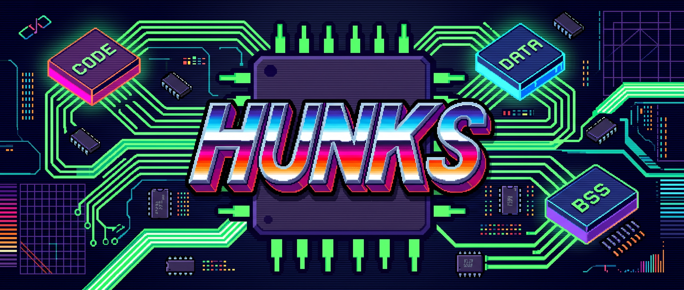

<p align="center">
  
</p>

# `hunks`

Amiga M68k Reverse Engineering System — terminal-native, keyboard-first disassembler, static call-graph analyzer, trace-seeded chipset analyzer, music module ripper, and interactive TUI (pure Go, zero CGo).

## Features

- **Workspace + Module namespacing (`-p <root>` + `-m <module>`)**: Automatically deduces `<module>` from binary filenames (`work/<module>/`, `src/<module>/hunk*.asm`, `disasm/<module>.asm`, shared `src/equates.i`) with `--force` overwrite protection so multiple binaries in the same workspace never collide
- **Unified 3-stage M68000 disassembler** for both multi-hunk AmigaOS executables (`HUNK_CODE`, `HUNK_DATA`, `HUNK_BSS`, `CHIP`/`FAST`) and flat ROM/disk binaries
- **Trace-seeded M68000 + Amiga OCS/ECS chipset analysis (`analyze --trace`)**: Built-in sandboxed M68000 interpreter (`m68kemu`) + deterministic Agnus/Denise/Paula/Blitter/Copper/8520-CIA state machine that resolves indirect dispatch, self-installed interrupt/trap handlers, and base-register hardware accesses by observation
- **Shared SQLite database (`work/<module>/project.db`)** and unified virtual address space across all segments of a module (powered by pure-Go `modernc.org/sqlite`)
- **Relocation-exact symbol resolution** (`HUNK_RELOC32` / `HUNK_DREL32`), automatic cross-hunk `XDEF` exports, and collision-free `LAB_<hunk>_<offset>` auto-labels (`LAB_5_24BE8`)
- **Source-linkable `; XREF:` comments** (`; XREF: hunk5:LAB_5_24E84 (jsr 498(a5))`) and automatic cross-hunk / jump-vector target hints (`; -> hunk3:LAB_3_26432`)
- **Static Call Graph CLI (`hunks -m <module> cg`)** with automatic `d16(a5)` jump-vector resolution, bottom-up `--ready` worklists, `--leaves`, `--anchors` (strings & `$DFFxxx` hardware), `--suspect` audits, and `--code` caller/callee inspection
- **Standalone Amiga music module scanner (`hunks rip <file>`)** with 26 ExoticRipper recognizers (including sandboxed self-executing M68000 driver probes for David Whittaker and Final Music System)
- **Interactive TUI (`hunks -m <module> tui`)** with full-width Sub-Row Code View, inline 16-byte `dc.b` hex/ASCII grid, 3-tier EOL comment priority, exact MC68000 instruction cycle & R/W bus timing, interactive **Amiga Bitplane Image Viewer & Ripper (`B`)** (Kitty/iTerm2/Sixel/Half-Block pixel graphics, `BPLCON0` 1–7 planes, EHB/HAM6, Copper/`$0RGB` palette extraction, PNG & `FORM ILBM` export), **TUI Music Ripper (`M`)** (scan, jump, rip, & carve), virtual segment `incbin` carves (`v` + `K` in editor, `K` in asset viewers with metadata block comments and round-trip on `B`), configurable truecolor themes (`~/.config/hunks/theme.json`), vertical scrollbar, floating modal overlays, byte-exact cursor splitting, cross-hunk `Enter` navigation, `x` XREFs modal, `f` Functions filter, and struct/alias editors
- **100% bit-for-bit reassembly** verified with `vasmm68k_mot`

## Quick Start

### Multi-Hunk AmigaOS Executable (`assets/frontier`)

```bash
go install ./cmd/hunks

# 1. Initialize 13-hunk module ('frontier' deduced -> work/frontier/), analyze, and emit modular assembly
hunks init --hunk-file assets/frontier
hunks -m frontier analyze
hunks -m frontier emit --amiga

# 2. Explore the call graph (leaves, hardware/string anchors, and function neighborhoods)
hunks -m frontier cg --anchors --unrenamed -n 20
hunks -m frontier cg hunk3:LAB_3_2649E --code

# 3. Assemble with vasmm68k_mot & verify load-image parity
vasmm68k_mot -Fhunkexe -kick1hunks -nosym -no-opt -I . -I src -o build/frontier disasm/frontier.asm
python3 scripts/verify_parity.py build/frontier assets/frontier
```

### Flat Binary Image (`assets/disk.1`)

```bash
# 1. Initialize module at fixed load address ('disk_1' deduced -> work/disk_1/)
hunks init --binary assets/disk.1 --base 0x3B800

# 2. Add entry point, analyze, and emit disasm/disk_1.asm
hunks -m disk_1 entry 0x63EC8 --name main
hunks -m disk_1 analyze
hunks -m disk_1 emit

# 3. Verify 100% bit-for-bit parity
vasmm68k_mot -m68000 -no-opt -Fbin -o build/disk_1.bin disasm/disk_1.asm
cmp -l assets/disk.1 build/disk_1.bin   # 0 differences

# 4. Launch interactive TUI
hunks -m disk_1 tui
```

## Documentation

- [MANUAL.md](MANUAL.md) — Complete user manual with CLI/TUI reference and end-to-end walkthroughs
- [ARCHITECTURE.md](ARCHITECTURE.md) — System internals: package map, data model (`project.json` + `project.db` schema), analyzer pipeline, emitter, and call graph
- [TESTING.md](TESTING.md) — Verification and regression test procedures
- [AGENTS.md](AGENTS.md) — Development guidelines, invariants, and coding standards
- [CODE_OF_CONDUCT.md](CODE_OF_CONDUCT.md) — Community code of conduct

## Development Workflow

### Prerequisites

- **Go 1.27+** (pure Go build; zero CGo dependencies)
- **`vasmm68k_mot`** (optional, required only when running end-to-end reassembly parity checks against local binaries)

### Build, Lint & Test

```bash
# Build all packages and the CLI binary
go build ./...
go build -o hunks ./cmd/hunks

# Run static analysis (must report 0 warnings)
go vet ./...

# Run the self-contained synthetic unit test suite (no external assets required)
go test -v ./...

# Install the `hunks` binary to $GOPATH/bin
go install ./cmd/hunks
```

### Verifying Load-Image Parity

Any change that touches the analyzer (`internal/analyzer`) or emitter (`internal/emitter`) must preserve 100% load-image parity on reference targets:

```bash
# Multi-hunk AmigaOS executable (compares hunk table, payloads, and order-independent RELOC32 sets)
hunks init --hunk-file assets/<target> --force
hunks -m <target> analyze
hunks -m <target> emit --amiga --force
vasmm68k_mot -Fhunkexe -kick1hunks -nosym -no-opt -I . -I src -o build/<target> disasm/<target>.asm
python3 scripts/verify_parity.py build/<target> assets/<target>

# Flat binary (compares raw assembled bytes 1:1)
vasmm68k_mot -m68000 -no-opt -Fbin -o build/<flat>.bin disasm/<flat>.asm
cmp -l assets/<flat> build/<flat>.bin
```

## Contributing

Contributions are welcome! Before opening a pull request, please review [AGENTS.md](AGENTS.md) and [ARCHITECTURE.md](ARCHITECTURE.md) and ensure your changes follow the project's core invariants:

1. **Branching & Commits:** Never commit directly to `main`/`master`. Create a focused feature or bugfix branch (`feat/...`, `fix/...`, `refactor/...`, `docs/...`) and use clear conventional commit messages explaining the rationale.
2. **100% Load-Image Parity:** Disassembly or emission changes must never break byte-for-byte reassembly (`vasmm68k_mot` + `scripts/verify_parity.py` / `cmp -l`).
3. **Self-Contained Synthetic Tests:** All unit tests in `*_test.go` must use synthetic byte slices and in-memory SQLite (`:memory:`). **Never commit or reference copyrighted Amiga game binaries, ROMs, or music modules** (`assets/`, `work/`, and `testdata/*` are gitignored).
4. **Architecture Boundaries:**
   - Keep all SQL queries encapsulated inside typed methods on `db.Controller` (`internal/db/`).
   - Keep domain kind strings (`CellType`, `EdgeKind`, `XrefKind`, `LabelKind`) strictly inside `internal/db/types.go`.
   - Preserve the one-way `emit` contract (never overwrite existing `.asm` files without `--force`).
5. **Clean Verification:** Run `go build ./...`, `go vet ./...`, and `go test ./...` with zero warnings or failures, and update [MANUAL.md](MANUAL.md) if CLI flags, TUI keys, or capabilities changed.

## Reference Targets (User-Supplied, Local Only)

### `assets/frontier` (*Frontier: Elite II*)
646,740-byte AmigaOS executable with 13 hunks (10 `CODE`, 1 `DATA,CHIP`, 2 `BSS`) and 2,882 relocations. Emits 159,000+ lines across `src/frontier/hunk0.asm` .. `src/frontier/hunk12.asm` and reassembles with 100% hunk payload and relocation parity.

### `assets/disk.1` (*Virus*)
180 KB flat binary loaded at `$3B800`, entry at `$63EC8`. Reassembles with 0 byte differences (`cmp -l`).

### `assets/daysofthunder/data/dot` (*Days of Thunder*)
284 KB WHDLoad game binary loaded at `$2E0`, entry at `$304`.

## License

Licensed under the [MIT License](LICENSE). Copyright (c) 2026 Mikolas Hämäläinen.
